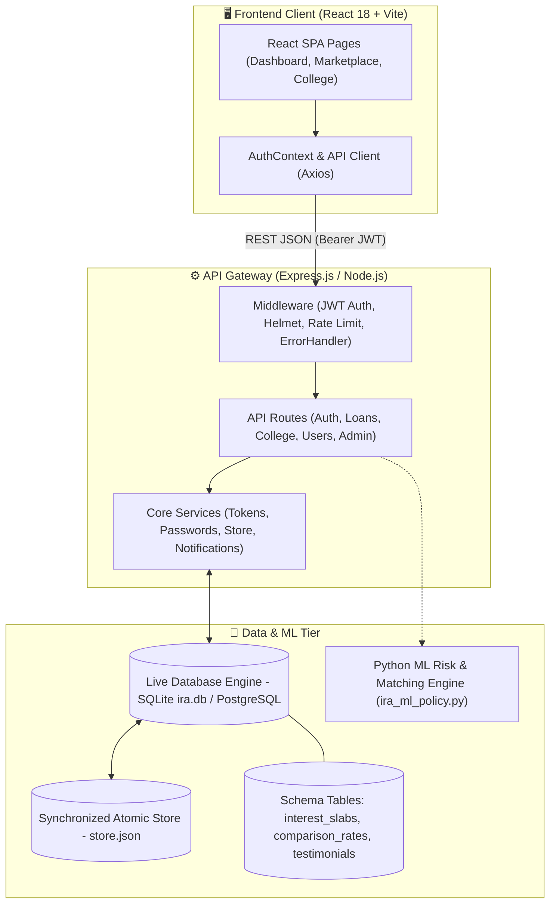
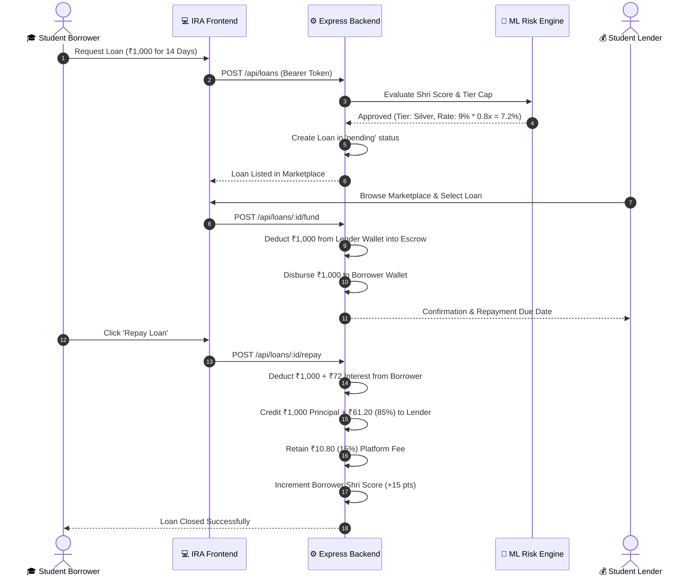

# 🪙 IRA — Student P2P Lending Platform
## 05. System Architecture & Component Interaction

---

## 🏛️ High-Level Architectural Diagram

---

## 🔄 Core Data Flow: The Loan Lifecycle

---

## 🧩 Architectural Component Responsibilities

| Component | Technology | Primary Responsibility |
|---|---|---|
| `frontend/src/App.tsx` | React 18, React Router v6 | Client routing, page hierarchy, route protection guards. |
| `frontend/src/services/api.ts` | Axios | Centralized HTTP interceptor with automatic token attachment. |
| `frontend/src/contexts/AuthContext.tsx` | React Context API | User session persistence, login/logout, and demo user switching. |
| `backend/server.js` | Express.js (ESM) | HTTP server bootstrapping, route mounting, and CORS configuration. |
| `backend/middleware/auth.js` | jsonwebtoken | JWT token verification, role enforcement (`user`, `college`, `admin`). |
| `backend/lib/store.js` | Node.js fs/promises | Thread-safe atomic JSON file operations for high-speed local persistence. |
| `backend/lib/passwords.js` | bcrypt | Salted password hashing, verification, and email normalisation. |
| `backend/lib/notifications.js` | Nodemailer / Twilio mock | Dispatching email OTPs, loan disbursement, and repayment notices. |
| `database/schema.sql` | PostgreSQL | 24 relational tables defining foreign keys, constraints, and audit logs. |
| `ml/ira_ml_policy.py` | Python 3 | High-precision Decimal loan matching, interest schedules, and Shri score adjustments. |
